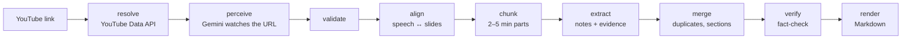

# StudyLoop

[](https://github.com/Dev-yadav2003/StudyLoop/actions/workflows/ci.yml)


[](LICENSE)

**Turn a YouTube lecture into clean, faithful study notes — with timestamps, practice
questions, and a library organised in chapters.**

Paste a link to a lecture. StudyLoop watches it — what the teacher **said** *and* what they
**showed** (slides, whiteboard, code) — and writes study notes where every concept links to
the moment it's taught. Every claim is checked against the lecture before you see it.

---

## Features

- **Notes from speech *and* screen.** Definitions, lists, steps and code come out as
  structured study notes — not a transcript.
- **Timestamps you can trust.** Each concept links to where it's taught (▶ `09:06`), computed
  from the evidence it cites — never guessed by the model.
- **Fact-checked.** Every note must cite the lecture; a separate check rewrites or drops
  anything the lecture doesn't support.
- **Working code.** Code is copied from the slides verbatim, with its printed output shown
  separately — checked to actually run in the eval suite.
- **Chapters and lessons.** Organise lectures into chapters (*Python*, *Java*, …); rename,
  move and delete in place.
- **Practice.** Recall and application questions generated only from your notes, with the
  answer and the moment it's taught; mark each *Got it* / *Review later*.
- **Edit and export.** Fix a note in place; copy or download the notes as Markdown.
- **Accounts.** Sign in with an email link. Owner accounts are unlimited; everyone else gets
  1 hour of lecture video, checked before any work starts.

## How it works



| Stage | AI? | What it does |
|---|---|---|
| **resolve** | – | Title, length and availability from the YouTube Data API. The video is never downloaded. |
| **perceive** | Gemini | Gemini reads the YouTube URL and returns timestamped speech plus every distinct screen ("board state") with its exact text. Videos over 10 minutes are read in overlapping clips, so a long lecture never exceeds the model's output limit. |
| **validate** | – | Fixes the model's timing slips: clips, sorts, de-duplicates, merges repeated slides. |
| **align** | – | Links speech to slides by time and by matching words (catches "a numerate" → `enumerate`). |
| **chunk** | – | Splits the lecture at slide changes into 2–5 minute parts (dynamic programming). |
| **extract** | Gemini | Writes notes per part. Code enforces the rules: every note cites evidence, quoted code must appear on a slide, timestamps come from the evidence. |
| **merge** | Gemini | One pass over the whole lecture: merges repeated concepts, sets 3–7 sections. Validated so nothing is lost. |
| **verify** | Gemini | Checks each note against only the evidence it cites; rewrites or drops unsupported claims. |
| **render** | – | Deterministic Markdown (same input, same output). |

Every stage's output is cached under a key built from its version, prompt version, model,
input and settings — so changing one prompt re-runs only that stage and the ones after it.
Every model call is traced in Langfuse with its tokens and cost.

## Quality

Measured by the eval suite (an independent judge model, plus code that actually runs the
extracted code), on recorded lectures:

| Lecture | Notes | Faithfulness | Repeated concepts | Code parses / runs / prints what it says |
|---|---|---|---|---|
| Python: `zip` & `enumerate` (6 min) | 4 | **100%** | 0% | **100% / 100% / 100%** |
| How to evaluate LLM apps (17 min) | 13 | **100%** | 8% | – |

Processing costs about **$0.20–0.25 for a 20-minute lecture** at Gemini's paid list prices
($0 on the free tier) and takes 2–4 minutes for a 10-minute lecture.

## Tech stack

| | |
|---|---|
| **Backend** | Python 3.12 · FastAPI · Pydantic v2 · SQLAlchemy 2 (async) + psycopg 3 · Alembic |
| **AI** | Gemini 2.5 Flash via LangChain (structured output, retries, fallbacks, key failover, rate limiting) · prompts as versioned YAML + Jinja2 |
| **Data** | Supabase Postgres — results, stage cache, job queue (`FOR UPDATE SKIP LOCKED`) and auth |
| **Observability** | Langfuse (trace per job, span per stage, cost per call) · structlog JSON logs |
| **Frontend** | Next.js 16 · React 19 · TypeScript · TanStack Query · client generated from the OpenAPI schema |
| **Quality** | pytest (455 tests, real Postgres, no network) · ruff · pyright · eval suite with LLM judges · GitHub Actions |

---

## Getting started

### Prerequisites

- Python **3.12** and Node.js **≥ 20.9**
- [uv](https://docs.astral.sh/uv/) (recommended) — or plain `pip`
- Free accounts / keys:
  - **Gemini API** key — [aistudio.google.com/apikey](https://aistudio.google.com/apikey)
  - **YouTube Data API v3** key — Google Cloud Console
  - **Supabase** project — Postgres + Auth
  - **Langfuse** project — tracing

### 1. Install

```bash
git clone https://github.com/Dev-yadav2003/StudyLoop.git
cd StudyLoop
uv sync                                  # Python dependencies (pinned by uv.lock)
cd apps/web && npm install && cd ../..   # web dependencies
```

<details>
<summary>Without uv (plain pip)</summary>

```bash
python -m venv .venv
.venv\Scripts\activate                 # macOS/Linux: source .venv/bin/activate
pip install -r requirements-dev.txt     # runtime only: requirements.txt
```

Then drop the `uv run` prefix from the commands below.
</details>

### 2. Configure

```bash
cp .env.example .env                          # API: fill in the REQUIRED section
cp apps/web/.env.example apps/web/.env.local  # web: Supabase URL + publishable key
```

Each value is documented in the file, including where to get it.

In Supabase → **Authentication → URL Configuration**, set **Site URL** to
`http://localhost:3000` and add `http://localhost:3000/**` to **Redirect URLs** (the
sign-in email links back there).

### 3. Create the database schema

```bash
uv run alembic upgrade head
```

### 4. Run

```bash
uv run lecnotes serve              # API + background worker → http://127.0.0.1:8000/docs
cd apps/web && npm run dev         # web app                 → http://localhost:3000
```

Open http://localhost:3000, sign in with the email you put in `OWNER_EMAILS`, create a
chapter and paste a lecture link. [`docs/local-testing.md`](docs/local-testing.md) walks
through everything worth trying.

### Command line

```bash
uv run lecnotes run <youtube-url> --preset stem     # writes notes/<video_id>.md, prints cost per stage
uv run lecnotes run <url> --rerun-from extract      # recompute from one stage; earlier stages from cache
uv run lecnotes run <url> --no-db --no-trace        # in-memory cache, no Langfuse
```

## Deploy

API on **Render** (free plan), web app on **Vercel** (Hobby). Deploy the API first: the web
app needs its URL, and the API needs the web app's URL for CORS.

**1. API → Render.** New → **Blueprint** → pick this repo. [`render.yaml`](render.yaml)
creates the service; fill in the secrets it asks for (same values as your `.env`). Leave
`CORS_ORIGINS` as `["http://localhost:3000"]` for now. Migrations run on every start. Check
`https://<service>.onrender.com/readyz` answers `"status": "ok"`.

**2. Web → Vercel.** Add New → Project → import this repo, set **Root Directory** to
`apps/web`, and add the three variables from `apps/web/.env.example` with
`NEXT_PUBLIC_API_URL` set to the Render URL. Deploy.

**3. Connect them.**
- Render → Environment: `CORS_ORIGINS=["https://<project>.vercel.app"]` (saving redeploys).
- Supabase → Authentication → URL Configuration: **Site URL** = the Vercel URL, and add
  `https://<project>.vercel.app/**` to **Redirect URLs**.

**Keeping the API awake.** Render's free plan sleeps after 15 minutes without traffic and
takes about a minute to wake — and a sleeping API also stops processing queued jobs. Two
things ping `/healthz` every 10 minutes: the web app (while it's open in a browser) and the
[`keep-alive`](.github/workflows/keep-alive.yml) workflow (always, once you set the repository
variable `API_URL` to the Render URL). An always-on service uses ~744 of the free plan's 750
instance-hours a month, so this works for one service only.

## Evaluation

```bash
uv run python -m evals.run --label "what changed"   # score the pipeline on recorded lectures
uv run python -m evals.run --label "…" --qa         #   + practice-question correctness
uv run python -m evals.run --label "…" --code-exec docker   #   + run extracted code in a sandbox
uv run python -m evals.compare --latest             # before/after: metrics, stages, latency, cost
```

Perception is replayed from `tests/fixtures/`, so evals use no YouTube quota and only re-run
what changed. Pull requests labelled `eval` run the suite in CI and fail if faithfulness or
key-point recall drops more than 5 points against `evals/baseline.json`.

Extracted code is untrusted (it comes from someone else's video): the app never runs it, and
evals run it only on request — in CI inside a locked-down Docker container (no network,
read-only, resource limits).

## Development

```bash
uv run ruff format . && uv run ruff check .   # format + lint
uv run pyright                                # type check
uv run pytest                                 # unit + integration — never touches the network
cd apps/web && npm run typecheck              # web types
```

Integration tests run against real Postgres: `TEST_DATABASE_URL`, or a throwaway cluster
started from local PostgreSQL binaries (`PG_BIN`); otherwise they are skipped.

**Dependencies:** `pyproject.toml` declares them, `uv.lock` pins every version, and
`requirements*.txt` are generated from the lock (CI fails if they drift):

```bash
uv add <package>
uv run python scripts/export_requirements.py
```

**After changing the API**, regenerate the web client types with the API running:
`cd apps/web && npm run gen:api`.

## Project structure

```
src/lecnotes/          core package
  domain/              Pydantic models (no I/O)
  pipeline/            orchestrator + stages (resolve … render, qa)
  llm/                 the only place that calls an LLM: gateway, models, pricing, key pool
  prompts/             versioned prompt files (<name>/v<N>.yaml)
  adapters/            Gemini, YouTube, caches, test fakes
  storage/             tables, repositories, Alembic migrations
  jobs/                Postgres job queue + runner
  observability/       Langfuse tracing, structured logging
apps/api/              FastAPI app: routers, auth, quotas
apps/web/              Next.js app
evals/                 metrics, LLM judges, run/compare, golden-set tooling
tests/                 unit + integration tests, fakes, recorded fixtures
docs/                  local testing guide, architecture decision records
```

## Limits and roadmap

- One video per link — playlists aren't supported ([ADR 0007](docs/adr/0007-single-video-scope.md)).
- On Gemini's free tier, requests are paced (~10/min), so a lecture takes a few minutes.
- Next: a hand-made golden set to measure completeness (key-point recall).

## Contributing

See [CONTRIBUTING.md](CONTRIBUTING.md) for the workflow (branches, Conventional Commits,
pull requests) and [SECURITY.md](SECURITY.md) to report a vulnerability.

## License

[MIT](LICENSE)
